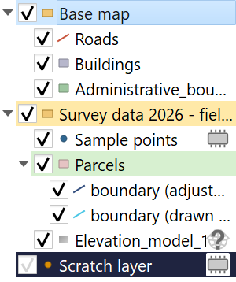
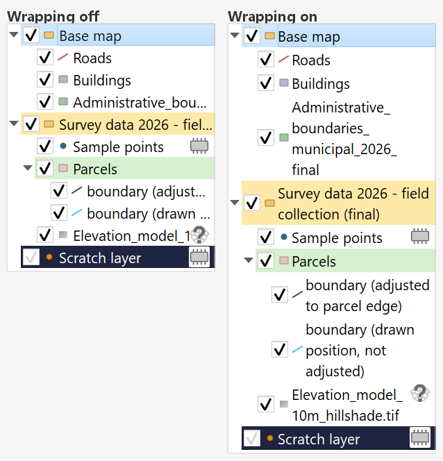

# Layer Color Plugin

Screenshots are drawn by this plugin's own layer tree delegate, using sample layer names.

This is a QGIS plugin that enables users to customize the background colors of layers and groups in the layer tree view, enhancing visual organization and project management. This plugin streamlines the organization and management of complex QGIS projects by allowing users to visually distinguish different layers through custom background colors. 

**Tip:** Always choose pastel or lighter colors. The code implements WCAG 2.0 contrast ratio checking to avoid colors that can make it hard to read the layer text. 

## Purpose
This plugin streamlines the organization and management of complex QGIS projects by allowing users to visually distinguish different layers through custom background colors.

## Usage
This plugin installs a menu in the layer options menu, called “Layer Highlight Color”, that can be used as follows:

- Right-click on any layer or group in the layer panel
- Navigate to “Layer Highlight Color” submenu
- Choose from available options:
  - Set Background Color
  - Copy Highlight Color
  - Paste Highlight Color
  - Remove Background Color

## Time-Saving Tips
### Batch Operations
- Select multiple layers of the same type
- Copy color from one reference layer for color consistency among several layers
- Paste to all selected layers simultaneously
- Create consistent color schemes across project sections

### Project Organization
- Use color intensity to show data hierarchy
- Apply similar colors to related data groups
- Create visual separation between different data themes
- Maintain consistent color coding across project updates

This visual organization system significantly reduces the time needed to locate and manage layers in projects with hundreds of datasets.

## Usage Examples
### Geological Mapping Project
- Color all geological unit layers in shades of brown
- Highlight active fault lines in bright red
- Mark geophysical survey areas in purple
- Group and color all borehole data in blue shades
- Distinguish different geological ages with color intensity variations

### Urban Planning Project
- Mark zoning layers in distinct pastel colors
- Highlight protected areas in green tones
- Color infrastructure layers in grayscale
- Group and color all transportation layers in warm colors
- Distinguish development phases with different color intensities

### Environmental Impact Study
- Color sensitive habitat areas in green
- Mark pollution monitoring points in red
- Highlight water bodies in blue shades
- Group and color all sampling locations in yellow
- Distinguish impact zones with gradient colors

### Archaeological Site Management
- Color different excavation periods in distinct hues
- Highlight artifact concentration areas in warm colors
- Mark survey grids in cool colors
- Group and color all dating samples in purple
- Distinguish conservation zones with specific color codes

## Features
### Color Management
- Set custom background colors for layers and groups in the layer panel
- Copy and paste colors between different layers
- Remove background colors from selected layers

### User Interface
- Adds a “Layer Highlight Color” submenu to the layer context menu
- Provides color selection through a standard color dialog
- Maintains color persistence across project saves and loads

### Long Name Wrapping (optional)
Long layer, group and symbology names are normally cut off with an ellipsis in the
Layers panel. This plugin can wrap them over several lines instead:

- Turn it on in **Plugins → Layer Color Plugin → Wrap Long Layer Names**, or from
  the **Layer Highlight Color** submenu in the layer context menu
- Only the rows that need it become taller; everything else keeps its usual height
- Names re-wrap when you resize the Layers panel
- Breaks are made at the separators names are built from (`_`, `-`, `.`, `/`), so a
  name reads as `ovezeti_` / `jel_terv_` / `feliratok` rather than being split
  mid-word. A name with no separators is broken wherever it has to be
- The setting is remembered between QGIS sessions and is off by default

### Layer Indicators
To color the rows, this plugin takes over the drawing of the layer tree, which
would otherwise hide QGIS's own layer indicators. It draws them itself instead, so
the small icons at the right of a row — temporary (scratch) layer, missing CRS,
broken layer, applied filter, embedded layer, notes — stay visible, together with
their tooltips. On a wrapped row the icons keep their normal size and line up with
the first line of the name.

### Accessibility
- Implements WCAG 2.0 contrast ratio checking
- Picks the layer name color automatically: the name is drawn in black or white,
  whichever contrasts better with the chosen background, measured against the
  WCAG AA threshold (4.5:1)
- Inverts the layer status icons on dark backgrounds so they stay readable

## Technical Details
### Color Handling
- Colors are stored in both memory and project files
- Uses custom properties to save color information with each layer
- Automatically updates the layer tree view when colors change

### Project Integration
- Automatically saves colors when the project is saved
- Restores color settings when projects are loaded
- Maintains color consistency across QGIS sessions

___Renato Henriques - University of Minho/Institute of Earth Sciences___
